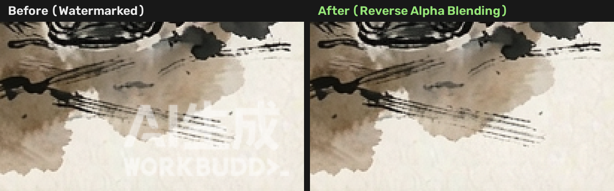
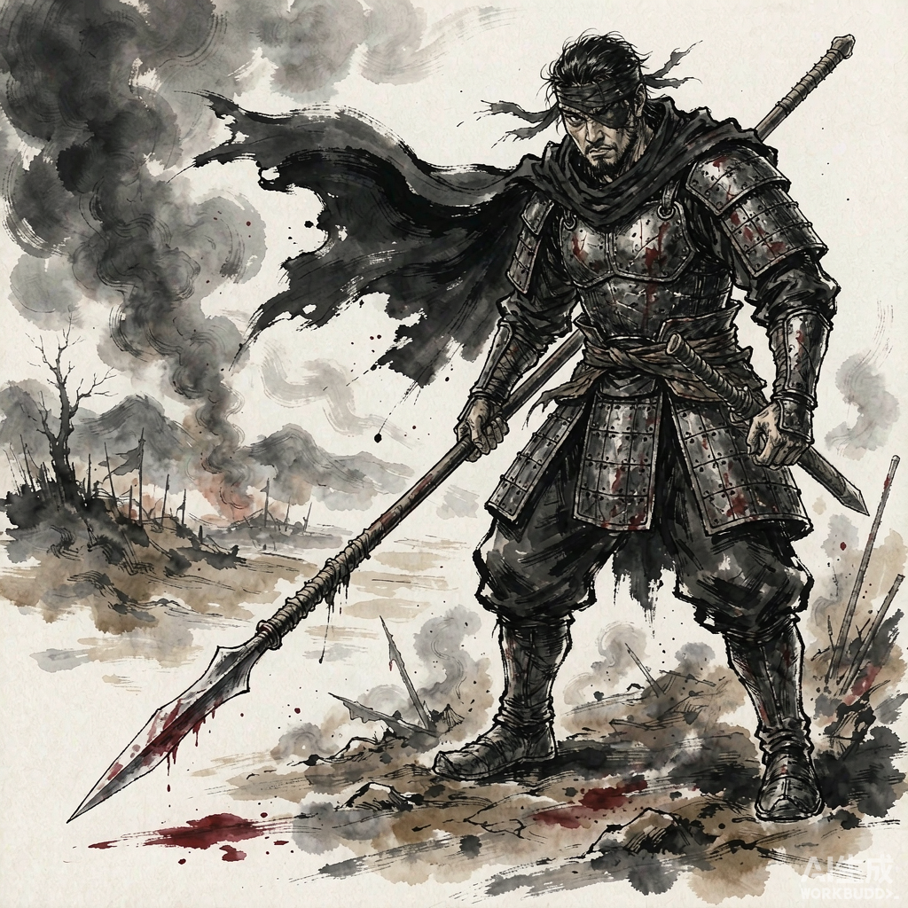

**English** | [简体中文](README.zh-CN.md)

# WorkBuddy Watermark Remover

A lightweight, lossless corner-watermark remover for WorkBuddy AI-generated images using **Reverse Alpha Blending**.

No deep learning models, no GPU, and no generative inpainting required. It recovers occluded pixels via exact mathematical inversion while keeping all non-watermark regions **100% bit-exact**.

---

## Visual Comparison

### Bottom-Right Corner Zoom (3x)



### Full Image Example

| Watermarked Input | Cleaned Output |
| :---: | :---: |
|  |  |

---

## Comparison with Other Approaches

| Dimension | AI Inpainting | Region Erase / Heuristic Mask | This Project (Exact Reverse Alpha Blending) |
| :--- | :--- | :--- | :--- |
| **Mechanism** | Detects the watermark region and regenerates pixels with a neural model | Erases the corner bounding box or estimates an approximate alpha mask | Applies exact per-pixel mathematical inversion using a calibrated alpha template |
| **Fidelity** | Rewrites underlying and surrounding pixels; prone to texture loss or artifacts | Affects background pixels between characters or leaves halos/shadows | **Restores only $\alpha > 0$ pixels; non-watermark pixels remain 100% bit-exact** |
| **Dependencies** | Large model weights; typically requires PyTorch / GPU | Lightweight, often relies on heuristic detection | **CPU-only; `numpy` + `opencv-python-headless`** |
| **Speed** | Slow (seconds per image) | Fast | **Instant (milliseconds per image; batch-friendly)** |
| **Best For** | Arbitrary opaque or complex watermarks | Fixed-position opaque watermarks | Semi-transparent overlay corner watermarks |

---

## How It Works

For a white (`255`) semi-transparent watermark, forward alpha compositing follows:

$$I_{\text{watermarked}} = (1 - \alpha) \cdot I_{\text{original}} + \alpha \cdot 255$$

1. **Calibrated Alpha Template**: On a pure-black reference image ($I_{\text{original}} = 0$, see `examples/black_ref.png`), the observed pixel intensity equals $255 \cdot \alpha$, yielding the exact grayscale alpha mask `assets/workbuddy_1024_alpha.png`.
2. **Reverse Alpha Blending**: For every pixel where $\alpha > 0$, the original color is recovered directly, while all other pixels remain untouched:

$$I_{\text{original}} = \frac{I_{\text{watermarked}} - 255 \cdot \alpha}{1 - \alpha}$$

---

## Project Structure

```text
workbuddy-watermark-remover/
├── assets/
│   └── workbuddy_1024_alpha.png   # Calibrated 1024x1024 alpha template
├── examples/
│   ├── input.png                  # Sample watermarked image
│   ├── output.png                 # Cleaned output image
│   ├── comparison.png             # 3x bottom-right comparison
│   └── black_ref.png              # Pure-black reference image for alpha extraction
├── scripts/
│   └── extract_alpha.py           # Extract alpha template from a pure-black reference
├── tests/
│   └── test_remover.py            # Unit tests
├── remove_watermark.py            # CLI entry point (single file & batch directory)
├── pyproject.toml
├── requirements.txt
└── LICENSE
```

---

## Quick Start

### 1. Install Dependencies

```bash
pip install -r requirements.txt
```

### 2. Clean a Single Image

```bash
# Default output: examples/input_clean.png
python remove_watermark.py examples/input.png

# Specify output path
python remove_watermark.py examples/input.png -o examples/output.png
```

### 3. Batch Process a Directory

```bash
# Default output directory: <input_dir>/cleaned/
python remove_watermark.py ./images

# Specify output directory
python remove_watermark.py ./images -o ./cleaned_images
```

### 4. Re-extract Alpha Template (Optional)

If the watermark layout or resolution changes in future versions, generate a new pure-black reference image and run:

```bash
python scripts/extract_alpha.py examples/black_ref.png -o assets/workbuddy_1024_alpha.png
```

---

## Running Tests

```bash
python -m unittest discover -s tests -v
```

---

## Disclaimer

This project is intended solely for educational and image-processing research purposes (Reverse Alpha Blending). Please respect the applicable terms of service and laws.

---

## License

[MIT](LICENSE)
