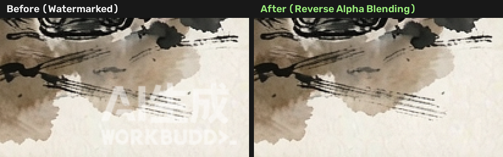
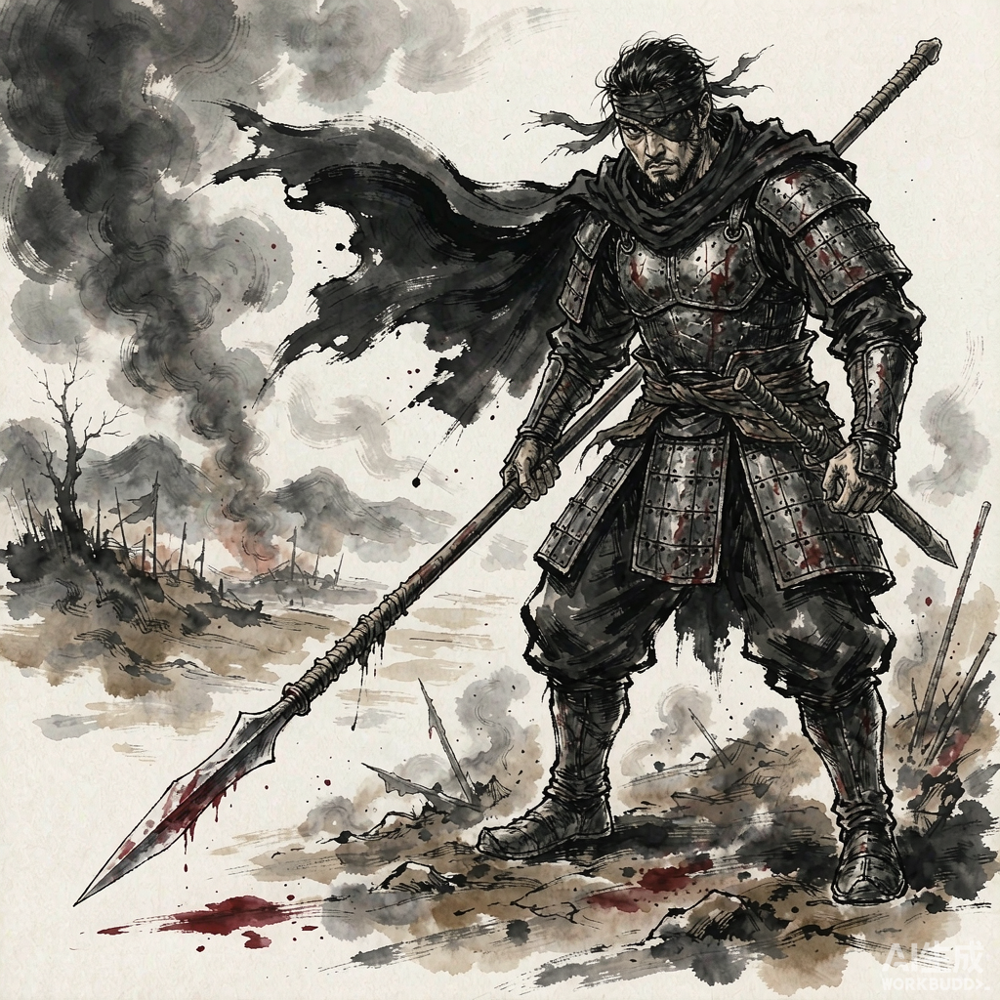

[English](README.md) | **简体中文**

# WorkBuddy Watermark Remover

基于**反向 Alpha 混合（Reverse Alpha Blending）**的 WorkBuddy AI 生成图像右下角水印去除工具。

无需深度学习大模型、无需 GPU、无需图像重绘（Inpainting），仅通过纯数学逆运算即可逐像素还原水印遮挡区域的原始色彩，同时保持非水印区域 **100% 比特级无损（Bit-exact）**。

---

## 效果对比

### 右下角水印区域局部放大对比（3x）



### 整图效果示例

| 原图（含水印） | 去水印后 |
| :---: | :---: |
|  |  |

---

## 与常见去水印方案的对比

| 对比维度 | AI 重绘方案（Inpainting） | 区域擦除 / 近似掩码方案 | 本方案（精确反向 Alpha 混合） |
| :--- | :--- | :--- | :--- |
| **实现原理** | 识别水印区域后通过生成模型重绘填充 | 对角标矩形区域整体抹除或使用近似掩码估算 | 基于精确 Alpha 模板对水印像素做数学逆运算 |
| **原图保真度** | 会重写水印下方与周边像素，纹理易失真 | 容易影响文字间隙背景，或因 Alpha 偏差残留白边/暗影 | **仅还原 $\alpha > 0$ 的像素，其余区域 100% 比特级无损** |
| **依赖与体积** | 需下载模型权重，通常依赖 PyTorch / GPU | 轻量，但常依赖额外启发式检测逻辑 | **仅需 `numpy` + `opencv-python-headless`，纯 CPU** |
| **处理速度** | 较慢（通常数秒/张） | 快 | **极快（毫秒级/张，适合批量处理）** |
| **适用场景** | 任意位置的不透明或复杂水印 | 固定位置的简单水印 | 半透明叠加型角标水印 |

---

## 核心原理

对于白色（`255`）半透明叠加水印，其正向 Alpha 混合公式为：

$$I_{\text{watermarked}} = (1 - \alpha) \cdot I_{\text{original}} + \alpha \cdot 255$$

1. **精确 Alpha 模板**：通过纯黑参考图（$I_{\text{original}} = 0$，见 `examples/black_ref.png`）可直接观测到 $255 \cdot \alpha$，从而提取出与实际渲染一致的灰度 Alpha 模板 `assets/workbuddy_1024_alpha.png`。
2. **反向 Alpha 混合还原**：仅在 $\alpha > 0$ 的像素上执行逆运算，其余像素保持原样：

$$I_{\text{original}} = \frac{I_{\text{watermarked}} - 255 \cdot \alpha}{1 - \alpha}$$

---

## 项目结构

```text
workbuddy-watermark-remover/
├── assets/
│   └── workbuddy_1024_alpha.png   # 1024x1024 精确 Alpha 模板
├── examples/
│   ├── input.png                  # 示例原图（含右下角水印）
│   ├── output.png                 # 去水印后效果图
│   ├── comparison.png             # 右下角 3x 局部放大对比图
│   └── black_ref.png              # 纯黑参考图（用于提取 Alpha 模板）
├── scripts/
│   └── extract_alpha.py           # 从纯黑参考图提取 Alpha 模板的脚本
├── tests/
│   └── test_remover.py            # 单元测试
├── remove_watermark.py            # 主程序（支持单图与目录批量处理）
├── pyproject.toml
├── requirements.txt
└── LICENSE
```

---

## 快速开始

### 1. 安装依赖

```bash
pip install -r requirements.txt
```

### 2. 去除单张图片水印

```bash
# 默认输出为 examples/input_clean.png
python remove_watermark.py examples/input.png

# 指定输出路径
python remove_watermark.py examples/input.png -o examples/output.png
```

### 3. 批量处理整个目录

```bash
# 默认输出到 <input_dir>/cleaned/
python remove_watermark.py ./images

# 指定输出目录
python remove_watermark.py ./images -o ./cleaned_images
```

### 4. 自定义 / 重新提取 Alpha 模板（可选）

如果后续水印样式或尺寸发生变化，可使用新的纯黑参考图重新生成 Alpha 模板：

```bash
python scripts/extract_alpha.py examples/black_ref.png -o assets/workbuddy_1024_alpha.png
```

---

## 运行测试

```bash
python -m unittest discover -s tests -v
```

---

## 免责声明

本项目仅用于图像处理算法学习与研究（Reverse Alpha Blending）。请遵守相关平台的服务条款与法律法规，勿将本工具用于违规用途。

---

## License

[MIT](LICENSE)
